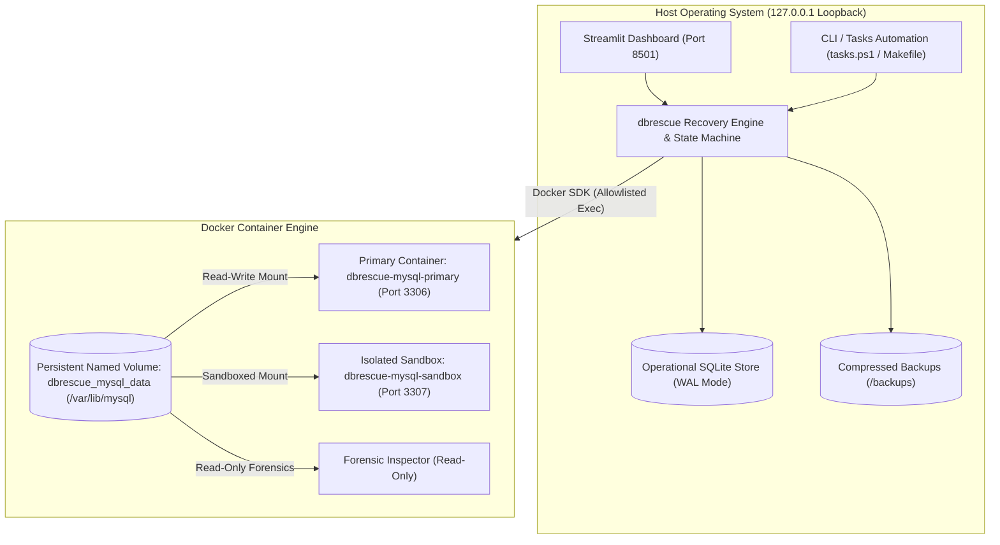

# dbrescue: Docker MySQL 8.4 LTS Disaster Recovery & Integrity Auditing Platform

[](https://github.com/Narendrapendli/dbrescue/actions/workflows/ci.yml)
[](https://www.python.org/)
[](https://github.com/astral-sh/ruff)
[](https://hub.docker.com/_/mysql)
[](docs/TEST_REPORT.md)
[](docs/TEST_REPORT.md)
[](LICENSE)

An enterprise-grade, automated disaster recovery, cryptographic integrity auditing, and observability platform for **Oracle MySQL 8.4 LTS** running in Docker.

> **Primary Objective (Task #38):**  
> Empirically prove that database records stored on a Docker named volume mounted at `/var/lib/mysql` survive complete container destruction and recreation with zero data loss, verified via row-level SHA-256 fingerprinting.

---

## 1. System Architecture



---

## 2. 18-Stage Disaster Recovery Lifecycle

The recovery engine executes a deterministic 18-stage state machine with strict transition graph validation and file-lock mutual exclusion:

```mermaid
flowchart TD
    S1["1. INIT_RUN (Generate UUID & Acquire Lock)"] --> S2["2. CHECK_DOCKER (Verify Engine Ping)"]
    S2 --> S3["3. LOCATE_VOLUME (Verify Named Volume)"]
    S3 --> S4["4. INSPECT_METADATA (Inspect Driver & Mounts)"]
    S4 --> S5["5. ATTACH_INSPECTOR (Mount Read-Only Helper)"]
    S5 --> S6["6. SCAN_DATA_FILES (Scan ibdata1 & IBD Tablespaces)"]
    S6 --> S7["7. CHECK_CORRUPTION (Inspect LSN & Dirty Flags)"]
    S7 --> S8["8. EXTRACT_FINGERPRINT (Pre-Recovery SHA-256 Baseline)"]
    S8 -->|"Requires confirm_destructive=True"| S9["9. PROVISION_SANDBOX (Isolate Environment)"]
    S9 --> S10["10. ATTACH_TARGET_VOLUME (Bind Preserved Volume)"]
    S10 --> S11["11. START_INSTANCE (Boot Container with Same Volume)"]
    S11 --> S12["12. AWAIT_HEALTHCHECK (Wait for MySQL Socket Ping)"]
    S12 --> S13["13. CONNECT_DATABASE (Establish Authenticated Pool)"]
    S13 --> S14["14. AUDIT_INTEGRITY (Query Post-Recovery Rows)"]
    S14 --> S15["15. CAPTURE_SNAPSHOT (Compute Post-Recovery Hashes)"]
    S15 --> S16["16. EXECUTE_BACKUP (Stream mysqldump through GZIP)"]
    S16 --> S17["17. VERIFY_BACKUP (Validate SHA-256 Checksum)"]
    S17 --> S18["18. FINALIZE_RUN (Compare Hashes & Emit Signed Report)"]
```



---

## 3. Key Capabilities & Features

1. **Deterministic Volume Persistence Proof (Task #38)**:
   - Proves named Docker volumes survive container destruction.
   - Compares pre-destruction baseline snapshots against post-recreation recovered data.
   - Evaluates row count delta and table-level SHA-256 cryptographic fingerprints.
2. **Defensive Safety Guards**:
   - Destruction requires an explicit confirmation token (`confirm_destructive=True`).
   - Grep guards strictly prohibit `down -v`, `volume rm`, and pruning anywhere in scripts or compose.
   - Cross-platform file locking (`logs/recovery.lock`) prevents concurrent destructive tasks.
3. **Logical Backup & Isolated Sandbox Restore**:
   - Streams `mysqldump` directly into GZIP with `--single-transaction`, `--routines`, and `--triggers`.
   - Never exposes passwords on command line arguments.
   - Re-verifies SHA-256 checksums from disk.
   - Restores into isolated sandbox databases (`dbrescue_restore_<id>`), verifies 100% parity, and drops the sandbox defensively.
4. **Evidence-Based Observability & Alerts**:
   - Alerts remain `NOT_EVALUATED` until real telemetry is recorded (zero false "OK" displays).
   - Real query latency measured via timed `SELECT 1;`.
   - Container CPU% and memory telemetry from Docker stats API.
5. **Modern Web Operations Console**:
   - Dark navy Streamlit dashboard (`#0A0F1D`) with responsive KPI cards, 18-stage workflow stepper, forensic audit explorer, and ReportLab PDF certificate generator.

---

## 4. Tech Stack & Pinned Versions

All dependencies are strictly pinned to exact verified releases:

| Component | Pinned Version | Ecosystem | Description |
| :--- | :--- | :--- | :--- |
| **MySQL Engine** | `mysql:8.4.3` | Docker Hub (Oracle LTS) | Long Term Support production database release |
| **Python** | `3.11`, `3.12`, `3.13` | Python Software Foundation | Core runtime environment |
| **Streamlit** | `1.39.0` | PyPI | Real-time web control plane and dashboard |
| **Docker SDK** | `7.1.0` | PyPI | Container lifecycle, volume inspection, exec sandboxing |
| **MySQL Connector** | `9.1.0` | PyPI | Official Oracle MySQL driver with connection pooling |
| **ReportLab** | `4.2.5` | PyPI | Vector PDF disaster recovery certificate generation |
| **Prometheus Client** | `0.21.0` | PyPI | Custom metrics instrumentation and exposition endpoint |
| **Prometheus Server**| `prom/prometheus:v2.55.1`| Docker Hub | Time-series metrics engine (monitoring profile) |
| **Grafana** | `grafana/grafana:11.3.0` | Docker Hub | Telemetry visualization (monitoring profile) |
| **mysqld-exporter** | `prom/mysqld-exporter:v0.16.0`| Docker Hub | Dedicated MySQL metrics exporter (monitoring profile) |
| **cAdvisor** | `gcr.io/cadvisor/cadvisor:v0.49.1`| Google Container Registry | Container resource collector (monitoring profile) |
| **Ruff** | `0.7.1` | PyPI | High-performance linter and code formatter |
| **Pytest** | `8.3.3` | PyPI | Acceptance test execution framework |

---

## 5. Repository Directory Layout

```text
dbrescue/
├── .github/
│   ├── workflows/ci.yml               # Multi-job CI pipeline (lint, unit, security, integration)
│   ├── dependabot.yml                 # Automated weekly pip & actions updates
│   └── pull_request_template.md       # PR checklist enforcing invariants
├── app/                               # Streamlit Web Application
│   ├── components/                    # KPI cards, status badges, workflow stepper, volume card
│   ├── pages/                         # Overview, Live Health, Persistence, Backup, Timeline, Alerts, Config
│   ├── main.py                        # Dashboard entrypoint and multi-page routing
│   ├── services.py                    # Strict boundary service layer consuming dbrescue backend
│   └── theme.py                       # Dark navy theme palette and styling
├── db/
│   ├── init/                          # 01_schema.sql, 02_users.sql, 03_exporter_user.sql
│   ├── seed/                          # seed_students.sql (realistic relational fixtures)
│   └── sqlite/                        # operational.db (SQLite WAL audit repository)
├── docker/
│   ├── conf/my.cnf                    # MySQL 8.4 LTS InnoDB & security tuning
│   └── Dockerfile.app                 # Containerized Streamlit deployment
├── docs/
│   ├── evidence/                      # Real run outputs, negative drill logs, backup evidence
│   ├── reports/                       # Certified vector PDF certificates and JSON summaries
│   ├── screenshots/                   # SCREENSHOTS_GUIDE.md and page visuals
│   ├── CHANGELOG.md                   # Engineering changelog across releases
│   ├── CONTRACTS.md                   # Formal API contracts and data models
│   ├── DEMO_SCRIPT.md                 # 5-minute executive presentation walkthrough
│   ├── MONITORING.md                  # Telemetry, Prometheus & Grafana runbook
│   ├── PROGRESS.md                    # Subsystem implementation progress matrix
│   ├── SECURITY_AUDIT.md              # Pre-release comprehensive security audit
│   └── TEST_REPORT.md                 # Automated acceptance test execution report
├── monitoring/
│   ├── grafana/                       # Auto-provisioned datasources & 13-panel dashboard JSON
│   ├── alert_rules.yml                # 7 production SLA alerting rules
│   └── prometheus.yml                 # Scrape configs for MySQL, cAdvisor, and DBRescue
├── scripts/
│   ├── db-seed.ps1 / .sh              # Database seeding scripts
│   ├── db-up.ps1 / .sh                # Container startup scripts
│   ├── make_test_report.py            # Automated TEST_REPORT.md generator
│   ├── run-tests.ps1 / .sh            # Cross-platform test runners
│   └── run_e2e_drills.py              # End-to-end recovery & negative drill runner
├── src/dbrescue/                      # Backend Core Python Engine
│   ├── alerts.py                      # Rule evaluation engine
│   ├── audit.py                       # SQLite WAL audit store & event logger
│   ├── backup.py                      # mysqldump GZIP streaming & SHA-256 hasher
│   ├── config.py                      # Strongly-typed configuration loader & SecretStr
│   ├── db.py                          # Connection pooling & ping checks
│   ├── docker_manager.py              # Safe Docker SDK sandboxing & exec allowlist
│   ├── integrity.py                   # Canonical row hashing & table fingerprinting
│   ├── lock.py                        # Cross-platform file lock (Windows + Linux)
│   ├── monitoring.py                  # Telemetry collector & freshness tracker
│   ├── recovery.py                    # 18-stage disaster recovery state machine
│   ├── reports.py                     # ReportLab PDF certificate compiler
│   ├── restore.py                     # Isolated sandbox database restore & parity
│   ├── retention.py                   # Backup retention policy manager
│   ├── security.py                    # Regex validators & log redaction filters
│   └── volume_inspector.py            # Named volume locator & InnoDB scan
├── tests/                             # Automated Test Suite (136 tests, 80% coverage)
├── compose.yaml                       # Core MySQL 8.4 & App composition (127.0.0.1 bound)
├── compose.monitoring.yaml            # Telemetry stack overlay (profile: monitoring)
├── Makefile                           # Standard Unix automation tasks
├── tasks.ps1                          # Windows PowerShell task runner
├── pyproject.toml                     # Packaging, pytest, and ruff configuration
├── requirements.txt                   # Production dependencies
├── requirements-dev.txt               # Testing and development dependencies
├── LICENSE                            # MIT License
└── SECURITY.md                        # Security policy and invariant rules
```

---

## 6. Prerequisites

- **Operating System**: Windows 10/11 (with PowerShell 7 or Windows PowerShell) or Linux (Ubuntu 22.04+, Debian 12+, RHEL 9+) / macOS.
- **Python**: Python 3.11, 3.12, or 3.13.
- **Docker**: Docker Desktop (Windows/macOS) or Docker Engine v24+ with Compose v2 (Linux).

---

## 7. Step-by-Step Setup from a Clean Checkout

### 1. Clone the Repository
```bash
git clone https://github.com/Narendrapendli/dbrescue.git
cd dbrescue
```

### 2. Configure Environment
Copy the example environment template:
```bash
# Windows PowerShell
Copy-Item .env.example .env

# Linux / macOS
cp .env.example .env
```

### 3. Initialize Virtual Environment & Install Dependencies
```bash
# Windows PowerShell
.\tasks.ps1 setup

# Linux / macOS
make setup
```

### 4. Start MySQL 8.4 LTS Infrastructure
```bash
# Windows PowerShell
.\tasks.ps1 up

# Linux / macOS
make up
```

### 5. Seed Realistic Database Fixtures
```bash
# Windows PowerShell
.\tasks.ps1 seed

# Linux / macOS
make seed
```

### 6. Launch the Operational Dashboard
```bash
# Windows PowerShell
.\tasks.ps1 run-app

# Linux / macOS
make run-app
```
Access the dashboard in your web browser at **`http://127.0.0.1:8501`**.

---

## 8. Configuration & Environment Variables

| Variable | Default Value | Sensitivity | Purpose |
| :--- | :--- | :---: | :--- |
| `DBRESCUE_ENV` | `development` | Low | Deployment environment mode (`development`, `ci`, `production`) |
| `DBRESCUE_LOG_LEVEL` | `INFO` | Low | Logging verbosity (`DEBUG`, `INFO`, `WARNING`, `ERROR`) |
| `DBRESCUE_SQLITE_PATH` | `./db/sqlite/operational.db` | Medium | Location of SQLite audit repository |
| `DBRESCUE_BACKUP_DIR` | `./backups` | Medium | Destination for compressed `.sql.gz` archives |
| `DBRESCUE_REPORTS_DIR`| `./docs/reports` | Low | Destination for compiled ReportLab PDF certificates |
| `MYSQL_PRIMARY_HOST` | `127.0.0.1` | High | Loopback IP for primary database container |
| `MYSQL_PRIMARY_PORT` | `3306` | Medium | Host bound port for MySQL |
| `MYSQL_DATABASE` | `student_db` | Low | Application database name |
| `MYSQL_USER` | `rescue_app` | High | Least-privilege application username |
| `MYSQL_PASSWORD` | `RescuePass2026!Secure` | Critical | Application user password |
| `MYSQL_ROOT_PASSWORD`| `RootRescue2026!Emergency`| Critical | Administrative password (bootstrap only) |
| `DOCKER_TARGET_VOLUME`| `dbrescue_mysql_data` | Low | Named persistent volume to verify |
| `GRAFANA_ADMIN_PASSWORD`| `GrafanaSecure2026!Pass`| Critical | Grafana dashboard admin password |

---

## 9. Network Port Bindings Table

All network listeners bind strictly to `127.0.0.1` (never `0.0.0.0`):

| Service | Port | Interface | Protocol | Access Policy |
| :--- | :---: | :---: | :---: | :--- |
| **MySQL Database** | `3306` | `127.0.0.1` | TCP | Authenticated MySQL protocol |
| **Streamlit Dashboard** | `8501` | `127.0.0.1` | HTTP | Local web console |
| **Prometheus Server** | `9090` | `127.0.0.1` | HTTP | Telemetry scraper & query engine (monitoring profile) |
| **Grafana UI** | `3000` | `127.0.0.1` | HTTP | Authenticated dashboard UI (monitoring profile) |
| **mysqld-exporter** | `9104` | `127.0.0.1` | HTTP | Prometheus metrics endpoint (monitoring profile) |
| **cAdvisor** | `8080` | `127.0.0.1` | HTTP | Container performance metrics (monitoring profile) |
| **dbrescue Exporter** | `9108` | `127.0.0.1` | HTTP | Custom DR Prometheus metrics |

---

## 10. How to Run Disaster Recovery Tests

### Option A: Via Streamlit Dashboard
1. Open `http://127.0.0.1:8501` and click **Persistence Tests** in the sidebar.
2. Click **Run Disaster Recovery Test**.
3. Type the safety confirmation token: `dbrescue-mysql-primary`.
4. Watch the 18 stages execute with live progress updates and inspect baseline vs. recovered hashes.

### Option B: Via Command Line
```powershell
# Windows PowerShell
.\tasks.ps1 test-persistence

# Linux / macOS
make test-persistence
```

### Option C: Run Full End-to-End Drills & Failure Injections
```bash
python scripts/run_e2e_drills.py
```
Executes the happy-path flow followed by 5 negative drills (tampered row, Docker down, volume missing, timeout, and missing token).

---

## 11. Backup, Verification & Restore Guide

### 1. Create a Compressed Logical Backup
```powershell
# Windows PowerShell
.\tasks.ps1 backup

# Linux / macOS
make backup
```
Generates a `.sql.gz` archive in `./backups/` and computes its cryptographic SHA-256 digest.

### 2. Verify Checksum & Dry-Run Isolated Restore
- Navigate to **Backup & Restore** in the dashboard.
- Select the backup archive and click **Recompute & Verify Checksum**.
- Under **Isolated Dry-Run Restore**, enter confirmation token `RESTORE-<id>`.
- The platform restores the archive into an ephemeral database (`dbrescue_restore_<id>`), verifies 100% row and fingerprint parity, and defensively drops the sandbox database.

---

## 12. Running Automated Tests

```bash
# Run unit, security, error, and backup test suites
pytest -m "not integration" -v

# Run full acceptance test suite and regenerate docs/TEST_REPORT.md
python scripts/make_test_report.py
```

See [docs/TEST_REPORT.md](docs/TEST_REPORT.md) for the latest empirical results (133 passed, 3 skipped, 80% coverage).

---

## 13. Optional Monitoring Stack (Prometheus & Grafana)

To start the Prometheus, Grafana, mysqld-exporter, and cAdvisor observability stack:
```bash
docker compose -f compose.yaml -f compose.monitoring.yaml --profile monitoring up -d
```
- **Prometheus**: `http://127.0.0.1:9090`
- **Grafana**: `http://127.0.0.1:3000` (User: `admin`, Password: `${GRAFANA_ADMIN_PASSWORD}`)
- Detailed guide: [docs/MONITORING.md](docs/MONITORING.md).

---

## 14. Screenshots & Sample Reports

- **Screenshots Guide**: Refer to [docs/screenshots/SCREENSHOTS_GUIDE.md](docs/screenshots/SCREENSHOTS_GUIDE.md) for visual capture steps for all 7 dashboard views.
- **Certified PDF Sample**: [`docs/reports/8380ad0d-5a0c-4a5d-a213-e787dff7dd76.pdf`](docs/reports/8380ad0d-5a0c-4a5d-a213-e787dff7dd76.pdf).
- **Certified JSON Summary**: [`docs/reports/8380ad0d-5a0c-4a5d-a213-e787dff7dd76.json`](docs/reports/8380ad0d-5a0c-4a5d-a213-e787dff7dd76.json).

---

## 15. Troubleshooting Guide

| Issue | Root Cause | Resolution |
| :--- | :--- | :--- |
| **Docker not running** | Docker Desktop engine is stopped or offline | Launch Docker Desktop and wait until the whale icon shows "Engine running". |
| **Port 3306 or 8501 in use** | A local MySQL instance or prior app is listening on the port | Identify process via `netstat -ano \| findstr 3306` (Windows) or `lsof -i :3306` (Linux) and stop it, or customize ports in `.env`. |
| **Named volume missing** | Container launched without volume or wrong name passed | Verify volumes with `docker volume ls`. Ensure `compose.yaml` volume `dbrescue_mysql_data` is used. |
| **Healthcheck timeout** | MySQL takes longer than 30s to initialize on slow disks | Increase `start_period` or `timeout` in `compose.yaml` under the MySQL healthcheck stanza. |
| **File lock stuck** | A prior run crashed while holding `logs/recovery.lock` | Remove `logs/recovery.lock` manually. The lock engine auto-expires stale locks after 120s. |
| **Permission errors on Windows** | NTFS permissions restricting SQLite or backup directory | Ensure the current user has write permissions to `./db/sqlite` and `./backups`. |
| **MySQL init scripts not re-running** | MySQL entrypoint only executes `/docker-entrypoint-initdb.d` on a completely empty volume | This is standard MySQL behavior. To re-seed data into an existing database, run `.\tasks.ps1 seed` (do NOT delete the volume!). |

---

## 16. Known Limitations & Future Improvements

### Known Limitations
1. **Single-Node Focus**: Designed for single-node MySQL 8.4 LTS Docker deployments. Multi-primary Galera or MySQL Group Replication clusters require cluster-aware consensus orchestration.
2. **Local Storage Bound**: Backup archives are stored on local host volumes or attached block storage.

### Future Roadmap
1. **S3 / Cloud Storage Offload**: Add direct streaming of encrypted `.sql.gz` backups to AWS S3, Google Cloud Storage, or Azure Blob Storage.
2. **Point-In-Time Recovery (PITR)**: Integrate MySQL binary log (`binlog`) continuous archiving for sub-minute RPO recovery.
3. **Physical XtraBackup Integration**: Support hot physical snapshots via Percona XtraBackup for multi-terabyte datasets exceeding logical dump performance.
