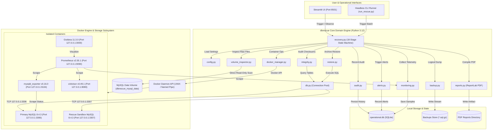
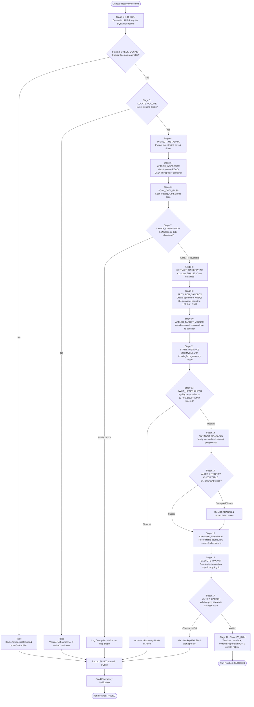

# Disaster Recovery & Volume Rescue Architecture Plan (`dbrescue`)

## 1. Executive Summary & Mission

`dbrescue` is an automated, secure, enterprise-grade Docker volume disaster recovery, integrity auditing, and observability platform specifically engineered for **MySQL 8.4 LTS** workloads. When MySQL database containers fail, suffer volume corruption, experience unclean shutdowns, or require emergency recovery without risk of secondary data loss, `dbrescue` orchestrates a fully isolated, 18-stage deterministic rescue workflow.

The platform provides:
1. **Zero-Destruction Volume Rescue**: Mounts corrupted or orphan Docker volumes in read-only safe mode, preventing cascading storage corruption.
2. **Deterministic 18-Step Recovery State Machine**: An auditable lifecycle transitioning from environment prechecks and InnoDB scans to isolated sandbox provisioning, checksum verification, and logical backup generation.
3. **Data Integrity & Cryptographic Fingerprinting**: Table-level row counts, primary key checksumming, and SHA256 storage fingerprinting to guarantee data consistency.
4. **Comprehensive Observability & Reporting**: Real-time Prometheus metrics, Grafana dashboards, automated alerts, and executive PDF recovery certificates rendered via ReportLab.
5. **Dual-Interface Management**: A Streamlit interactive web console backed by a standalone CLI engine for headless disaster recovery automations.

---

## 2. Architecture & Component Responsibilities

The system is decoupled into five primary tiers:
- **Core Engine (`src/dbrescue/`)**: Pure Python modular domain logic with strict type annotations, unified error handling, and zero coupling to UI frameworks.
- **Presentation Layer (`app/`)**: Interactive Streamlit web interface with dedicated consoles for live workflow orchestration, volume inspection, integrity audits, and metric visualization.
- **Storage & Infrastructure Layer (`docker/`, `db/`)**: Pinned MySQL 8.4 LTS container configurations, custom entrypoints, and declarative compose topologies.
- **Observability Stack (`monitoring/`)**: Prometheus, Grafana, mysqld_exporter, and cAdvisor running alongside internal Prometheus Python clients.
- **Operational Metadata Repository**: A local SQLite database (`operational.db`) capturing immutable run histories, snapshots, audit trails, and backups.

```
+--------------------------------------------------------------------------------------------------+
|                                    PRESENTATION LAYER (Streamlit)                                |
|  [ Dashboard ]  [ Recovery Console ]  [ Volume Inspector ]  [ Backups & Restore ]  [ Reports ]   |
+-------------------------------------------------+------------------------------------------------+
                                                  |
+-------------------------------------------------v------------------------------------------------+
|                                      CORE ENGINE (src/dbrescue)                                  |
|  +--------------------+  +--------------------+  +--------------------+  +--------------------+  |
|  |     recovery       |  |  volume_inspector  |  |   docker_manager   |  |     integrity      |  |
|  | (18-stage machine) |  | (InnoDB scan & LSN)|  | (Lifecycle & sandbox) | (Checksum & diffs) |  |
|  +--------------------+  +--------------------+  +--------------------+  +--------------------+  |
|  +--------------------+  +--------------------+  +--------------------+  +--------------------+  |
|  |      backup        |  |      restore       |  |     monitoring     |  |       alerts       |  |
|  | (mysqldump & gzip) |  | (Dry-run & verify) |  | (Prometheus exporter) | (Rule evaluation)  |  |
|  +--------------------+  +--------------------+  +--------------------+  +--------------------+  |
|  +--------------------+  +--------------------+  +--------------------+  +--------------------+  |
|  |       audit        |  |      reports       |  |         db         |  |       config       |  |
|  | (SQLite event log) |  |  (ReportLab PDF)   |  |  (Connector pool)  |  | (Pydantic / dotenv)|  |
|  +--------------------+  +--------------------+  +--------------------+  +--------------------+  |
+-------------------------------------------------+------------------------------------------------+
                                                  |
           +--------------------------------------+--------------------------------------+
           |                                                                             |
+----------v---------------------------------------------+ +-----------------------------v---------+
|                  DOCKER INFRASTRUCTURE                 | |             STORAGE INFRASTRUCTURE    |
|  +-----------------------------+  +------------------+ | |  +----------------------------------+ |
|  |   Primary MySQL 8.4 LTS     |  | mysqld_exporter  | | |  | MySQL Data Volume (Named/Bind)   | |
|  |   (Bound 127.0.0.1:3306)    |  | (Port 9104)      | | |  | - ibdata1, *.ibd, undo/redo logs | |
|  +-----------------------------+  +------------------+ | |  +----------------------------------+ |
|  +-----------------------------+  +------------------+ | |  +----------------------------------+ |
|  |   Rescue Sandbox MySQL      |  | cAdvisor         | | |  | SQLite Operational Store         | |
|  |   (Bound 127.0.0.1:3307)    |  | (Port 8080)      | | |  | - operational.db                 | |
|  +-----------------------------+  +------------------+ | |  +----------------------------------+ |
|  +-----------------------------+  +------------------+ | |  +----------------------------------+ |
|  |   Prometheus Server         |  | Grafana UI       | | |  | Backups Directory                | |
|  |   (Port 9090)               |  | (Port 3000)      | | |  | - *.sql.gz & *.sha256            | |
|  +-----------------------------+  +------------------+ | |  +----------------------------------+ |
+--------------------------------------------------------+ +---------------------------------------+
```

### Component Responsibility Breakdown

| Component | Module / Directory | Primary Responsibilities |
| :--- | :--- | :--- |
| **Configuration Manager** | `src/dbrescue/config.py` | Loads and validates environment variables from `.env` or system environment; enforces strict type validation and port constraints; provides immutable configuration objects to all subsystems. |
| **Database Connector** | `src/dbrescue/db.py` | Manages authenticated connection pools to MySQL instances via `mysql-connector-python`; provides query execution, transactional safety, socket health checks, and connection retry logic. |
| **Docker Manager** | `src/dbrescue/docker_manager.py` | Wraps official Docker Python SDK; controls container lifecycle (provisioning, sandboxing, network isolation, health monitoring, graceful teardown); enforces loopback port binding (`127.0.0.1`). |
| **Volume Inspector** | `src/dbrescue/volume_inspector.py` | Inspects host mounts and Docker named volumes; validates filesystem permissions; parses InnoDB physical structures (`ibdata1`, tablespaces `.ibd`, redo logs); calculates storage sizes and uncompressed metrics. |
| **Integrity Engine** | `src/dbrescue/integrity.py` | Executes table-level audits (`CHECK TABLE ... EXTENDED`); gathers row counts; computes deterministic cryptographic row fingerprints; detects anomalies between baseline and recovered states. |
| **Recovery Orchestrator** | `src/dbrescue/recovery.py` | Coordinates the 18-stage disaster recovery state machine; handles step transitions, failure catches, automatic rollbacks, and recovery state persistence. |
| **Backup Manager** | `src/dbrescue/backup.py` | Generates consistent logical backups using `mysqldump` with `--single-transaction` and `--quick`; streams archives through gzip; computes and stores SHA256 integrity checksums. |
| **Restore Engine** | `src/dbrescue/restore.py` | Restores databases from backup archives; validates archive SHA256 signatures prior to ingestion; executes dry-run syntax checks; verifies post-restore row count parity. |
| **Monitoring Subsystem** | `src/dbrescue/monitoring.py` | Instruments recovery operations using `prometheus_client`; tracks recovery durations, table count discrepancies, failure rates, and exporter scrape states. |
| **Alerting Subsystem** | `src/dbrescue/alerts.py` | Evaluates threshold rules against run metrics; classifies severity (`INFO`, `WARNING`, `CRITICAL`); persists alert records in SQLite; formats webhook and console notifications. |
| **Audit Subsystem** | `src/dbrescue/audit.py` | Implements an immutable, append-only SQLite event store; captures timestamps, execution stages, actors, JSON payloads, and exit statuses for forensic compliance. |
| **Report Generator** | `src/dbrescue/reports.py` | Compiles detailed disaster recovery and audit reports into production-grade PDF documents using ReportLab; embeds tables, charts, status badges, and data integrity hashes. |
| **Streamlit Dashboard** | `app/` | Provides an operations dashboard with live status cards, step-by-step recovery visualization, volume browsing, backup restoration controls, and PDF report downloads. |

---

## 3. Full Repository Structure

```
AWS PROJECT/
├── .github/
│   └── workflows/
│       ├── ci.yml                     # Ruff linter, type checking, pytest unit & backup suite
│       └── security.yml               # Trivy container scan, Bandit static security scan
├── .env.example                       # Documented template of environment variables
├── .gitignore                         # Git exclusion rules (venv, .env, *.db, artifacts)
├── README.md                          # Quickstart, architecture overview, and usage instructions
├── pyproject.toml                     # Tool configurations (ruff, pytest, mypy)
├── requirements.txt                   # Production pinned dependencies
├── requirements-dev.txt               # Testing and development dependencies
├── app/                               # Streamlit Web Application
│   ├── main.py                        # Entrypoint & navigation hub
│   ├── components/
│   │   ├── __init__.py
│   │   ├── metrics_card.py            # KPI metric cards with change indicators
│   │   ├── recovery_timeline.py       # 18-step interactive recovery stepper component
│   │   ├── status_badge.py            # Standardized status badge renderers
│   │   └── terminal_stream.py         # Real-time log streamer component
│   └── pages/
│       ├── 1_Dashboard.py             # System telemetry & container health
│       ├── 2_Recovery_Console.py      # Trigger and monitor 18-stage recovery
│       ├── 3_Volume_Inspector.py      # Inspect Docker storage & InnoDB layout
│       ├── 4_Backups_and_Restore.py   # Manage backups, checksums & restores
│       ├── 5_Integrity_Audit.py       # Row counts, fingerprints & schema audit
│       └── 6_Reports_and_Audit.py     # SQLite audit log & ReportLab PDF exports
├── db/                                # Database Assets
│   ├── init/
│   │   ├── 01_schema.sql              # MySQL enterprise reference schema
│   │   └── 02_seed.sql                # High-volume synthetic seed data
│   └── sqlite/
│       └── migrations/
│           ├── 001_initial_schema.sql # SQLite operational store schema
│           └── 002_add_indices.sql    # Performance indices for telemetry & audit
├── docker/                            # Container Infrastructure
│   ├── Dockerfile.app                 # Streamlit application image
│   ├── Dockerfile.mysql               # MySQL 8.4 LTS customized image
│   ├── docker-compose.yml             # Primary stack (MySQL, Streamlit, Volumes)
│   ├── docker-compose.monitoring.yml  # Observability stack (Prometheus, Grafana, Exporters)
│   └── conf/
│       ├── my.cnf                     # MySQL 8.4 LTS configuration (strict 127.0.0.1)
│       └── mysqld-exporter.cnf        # Exporter database credentials
├── docs/                              # Project Documentation & Artifacts
│   ├── PLAN.md                        # Comprehensive system plan & architecture
│   ├── CONTRACTS.md                   # Strict Python interfaces, enums & schemas
│   ├── evidence/                      # Verification logs, test outputs & audit proofs
│   ├── screenshots/                   # Dashboard & Grafana UI screenshots
│   └── reports/                       # Generated ReportLab recovery PDF samples
├── monitoring/                        # Observability Configurations
│   ├── prometheus.yml                 # Prometheus scrape targets & intervals
│   ├── alert_rules.yml                # Prometheus alert definitions
│   └── grafana/
│       ├── provisioning/
│       │   ├── dashboards/
│       │   │   └── dashboards.yml     # Automated dashboard loader
│       │   └── datasources/
│       │       └── prometheus.yml     # Pre-configured Prometheus datasource
│       └── dashboards/
│           └── mysql_overview.json    # Complete MySQL 8.4 metrics dashboard
├── scripts/                           # Operational & Utility Scripts
│   ├── bootstrap.ps1                  # Windows PowerShell environment bootstrap
│   ├── bootstrap.sh                   # Linux / macOS environment bootstrap
│   ├── generate_report.py             # Headless ReportLab PDF generator
│   ├── run_rescue.py                  # Headless 18-stage disaster recovery runner
│   ├── seed_data.py                   # Populates MySQL with verifiable seed data
│   └── simulate_disaster.py           # Chaos testing script (kills, corrupts, breaks)
├── src/
│   └── dbrescue/                      # Core Domain Package
│       ├── __init__.py
│       ├── alerts.py                  # Alert thresholds and dispatching
│       ├── audit.py                   # Immutable SQLite audit store
│       ├── backup.py                  # Logical mysqldump, compression & hashing
│       ├── config.py                  # Pydantic environment configuration
│       ├── db.py                      # MySQL connection pooling & queries
│       ├── docker_manager.py          # Docker SDK container lifecycle & isolation
│       ├── integrity.py               # Table audit, checksums & fingerprints
│       ├── monitoring.py              # Prometheus metrics collector
│       ├── recovery.py                # 18-stage state machine orchestrator
│       ├── reports.py                 # ReportLab PDF report generation
│       ├── restore.py                 # Archive restoration & post-audit
│       └── volume_inspector.py        # Physical volume & InnoDB scanner
└── tests/                             # Comprehensive Automated Test Suite
    ├── __init__.py
    ├── conftest.py                    # Pytest fixtures (Docker, SQLite, mock MySQL)
    ├── app/
    │   ├── test_components.py         # UI component rendering tests
    │   └── test_pages.py              # Page state and navigation tests
    ├── backup/
    │   ├── test_backup_engine.py      # mysqldump stream & gzip verification
    │   ├── test_checksum.py           # SHA256 integrity validation tests
    │   └── test_restore_roundtrip.py  # End-to-end backup-and-restore parity test
    ├── integration/
    │   ├── test_docker_lifecycle.py   # Container launch, network & kill tests
    │   ├── test_mysql_connection.py   # Connection pool & query execution tests
    │   └── test_recovery_workflow.py  # 18-stage state machine integration test
    ├── security/
    │   ├── test_credential_hygiene.py # Ensures zero plaintext passwords in code/logs
    │   ├── test_injection.py          # SQL injection resistance tests
    │   └── test_network_isolation.py  # Confirms 127.0.0.1 host binding only
    └── unit/
        ├── test_alerts.py             # Rule matching and notification tests
        ├── test_audit.py              # SQLite audit persistence tests
        ├── test_config.py             # Config loading & validation tests
        ├── test_integrity.py          # Fingerprint and checksum algorithms
        ├── test_reports.py            # PDF compilation and structure tests
        └── test_volume_inspector.py   # Filesystem parsing & InnoDB checks
```

---

## 4. Pinned Dependencies & Container Image Tags

### 4.1 Python Dependencies (Verified on PyPI)

Every dependency is pinned to an exact release verified to exist on the Python Package Index (PyPI):

| Package Name | Pinned Version | PyPI Verification Status | Role in Platform |
| :--- | :--- | :--- | :--- |
| **`streamlit`** | `1.39.0` | **Verified** (Released Oct 2024) | Operational web dashboard, real-time stage tracking, volume inspector UI. |
| **`docker`** | `7.1.0` | **Verified** (Released May 2024) | Official Docker SDK for Python; container lifecycle, volume mounts, network sandboxing. |
| **`mysql-connector-python`**| `9.1.0` | **Verified** (Released Oct 2024) | Official Oracle MySQL driver; pooled database connectivity, query execution, health checks. |
| **`pandas`** | `2.2.3` | **Verified** (Released Sep 2024) | Tabular data processing for snapshot comparisons, integrity tables, and telemetry aggregation. |
| **`plotly`** | `5.24.1` | **Verified** (Released Sep 2024) | Interactive visualization charts for recovery timeline, query throughput, and memory usage. |
| **`altair`** | `5.4.1` | **Verified** (Released Sep 2024) | Declarative statistical charting integrated natively with Streamlit. |
| **`reportlab`** | `4.2.5` | **Verified** (Released Oct 2024) | Enterprise programmatic PDF compilation for disaster recovery certificates. |
| **`prometheus-client`** | `0.21.0` | **Verified** (Released Oct 2024) | Custom Prometheus metrics instrumentation and exposition endpoint. |
| **`python-dotenv`** | `1.0.1` | **Verified** (Released Feb 2024) | Environment variable loading from `.env` with strict system fallback. |
| **`pytest`** | `8.3.3` | **Verified** (Released Sep 2024) | Core test runner for unit, integration, backup, and security suites. |
| **`ruff`** | `0.7.1` | **Verified** (Released Oct 2024) | Rust-powered high-performance linter and code formatter. |

### 4.2 Container Image Tags (Verified on Docker Hub)

To ensure zero breaking changes and eliminate unpredictability, floating tags like `:latest` or `:8` are strictly prohibited. All images use immutable, verified tags:

| Container / Service | Image Repository | Pinned Tag | Base OS / Architecture | Description |
| :--- | :--- | :--- | :--- | :--- |
| **MySQL Database** | `mysql` | `8.4.3` | Oracle Linux 9 (`linux/amd64`, `arm64`) | Oracle MySQL 8.4 Long Term Support (LTS) official release. |
| **MySQL Exporter** | `prom/mysqld-exporter` | `v0.16.0` | Distroless (`linux/amd64`, `arm64`) | Prometheus exporter for MySQL server metrics. |
| **Prometheus** | `prom/prometheus` | `v2.55.1` | Distroless (`linux/amd64`, `arm64`) | Time-series metrics collection and alert evaluation engine. |
| **Grafana** | `grafana/grafana` | `11.3.0` | Alpine Linux (`linux/amd64`, `arm64`) | Visualization dashboard for infrastructure and database telemetry. |
| **cAdvisor** | `gcr.io/cadvisor/cadvisor`| `v0.49.1` | Distroless (`linux/amd64`, `arm64`) | Container resource usage and performance metrics collector. |

---

## 5. Configuration, Environment Variables & Port Mappings

### 5.1 Environment Variables Specification

All environment variables follow strict naming conventions, carry secure defaults for local isolation, and are loaded via `dbrescue.config.AppConfig`.

| Variable Name | Default Value | Purpose | Sensitivity |
| :--- | :--- | :--- | :--- |
| `DBRESCUE_ENV` | `development` | Deployment environment (`development`, `staging`, `production`). | Low |
| `DBRESCUE_LOG_LEVEL` | `INFO` | Logging threshold (`DEBUG`, `INFO`, `WARNING`, `ERROR`). | Low |
| `DBRESCUE_SQLITE_PATH` | `./db/sqlite/operational.db` | Local path to SQLite operational metadata repository. | Medium |
| `DBRESCUE_BACKUP_DIR` | `./backups` | Target directory for compressed `.sql.gz` backup artifacts. | Medium |
| `DBRESCUE_REPORTS_DIR` | `./docs/reports` | Target directory for generated ReportLab recovery PDFs. | Low |
| `MYSQL_PRIMARY_HOST` | `127.0.0.1` | Hostname/IP of primary MySQL container (must be loopback). | High |
| `MYSQL_PRIMARY_PORT` | `3306` | External exposed port for primary MySQL instance. | Medium |
| `MYSQL_SANDBOX_HOST` | `127.0.0.1` | Hostname/IP of isolated rescue sandbox MySQL container. | High |
| `MYSQL_SANDBOX_PORT` | `3307` | External exposed port for rescue sandbox MySQL instance. | Medium |
| `MYSQL_DATABASE` | `rescue_ecommerce` | Default target database name for operations and audits. | Low |
| `MYSQL_USER` | `rescue_user` | Non-root application database user with limited privileges. | High |
| `MYSQL_PASSWORD` | `RescuePass2026!Secure` | Password for application database user. | High |
| `MYSQL_ROOT_PASSWORD` | `RootRescue2026!Emergency`| Superuser password required for maintenance and raw dumps. | Critical |
| `DOCKER_PRIMARY_CONTAINER`| `dbrescue-mysql-primary`| Name of standard production MySQL Docker container. | Low |
| `DOCKER_SANDBOX_CONTAINER`| `dbrescue-mysql-sandbox`| Name of ephemeral isolated rescue Docker container. | Low |
| `DOCKER_TARGET_VOLUME` | `dbrescue_mysql_data` | Target Docker volume name holding MySQL data directory. | Medium |
| `PROMETHEUS_METRICS_PORT`| `9108` | Local port exposing `dbrescue` internal Prometheus metrics.| Low |
| `STREAMLIT_SERVER_PORT` | `8501` | Local port for Streamlit web UI. | Low |

### 5.2 Network Port Bindings (Strict 127.0.0.1 Binding)

> [!IMPORTANT]
> To eliminate external attack vectors and prevent unauthorized database exposure, **every MySQL port is strictly bound to `127.0.0.1`**. Exposure to `0.0.0.0` or public network interfaces is blocked at container configuration time.

| Service Name | Container Port | Host Port Mapping | Protocol | Purpose | Security Policy |
| :--- | :--- | :--- | :--- | :--- | :--- |
| **Primary MySQL** | `3306` | `127.0.0.1:3306` | TCP | Standard database traffic | Host loopback only; restricted password auth. |
| **Sandbox MySQL** | `3306` | `127.0.0.1:3307` | TCP | Isolated rescue inspection | Host loopback only; ephemeral lifecycle. |
| **Streamlit UI** | `8501` | `127.0.0.1:8501` | HTTP | Operational web console | Host loopback binding. |
| **mysqld_exporter**| `9104` | `127.0.0.1:9104` | HTTP | MySQL engine metrics | Scraped solely by Prometheus network. |
| **cAdvisor** | `8080` | `127.0.0.1:8080` | HTTP | Docker telemetry exporter | Scraped solely by Prometheus network. |
| **Prometheus** | `9090` | `127.0.0.1:9090` | HTTP | Time-series scraper & UI | Host loopback binding. |
| **Grafana** | `3000` | `127.0.0.1:3000` | HTTP | Telemetry visualization | Host loopback binding; credential protected. |
| **Python Metrics** | `9108` | `127.0.0.1:9108` | HTTP | `dbrescue` domain metrics | Scraped solely by Prometheus network. |

---

## 6. Schemas & Data Architecture

### 6.1 MySQL Enterprise Primary Schema (`rescue_ecommerce`)

The reference database models an e-commerce platform. It features transactional tables, foreign key constraints, high-cardinality indices, and audit tables designed to reveal corruption or data loss under stress testing:

```sql
CREATE DATABASE IF NOT EXISTS rescue_ecommerce
  CHARACTER SET utf8mb4
  COLLATE utf8mb4_0900_ai_ci;

USE rescue_ecommerce;

-- Customers table
CREATE TABLE IF NOT EXISTS customers (
    customer_id BIGINT AUTO_INCREMENT PRIMARY KEY,
    uuid VARCHAR(36) NOT NULL UNIQUE,
    full_name VARCHAR(120) NOT NULL,
    email VARCHAR(160) NOT NULL UNIQUE,
    phone VARCHAR(32),
    status ENUM('ACTIVE', 'SUSPENDED', 'ARCHIVED') DEFAULT 'ACTIVE',
    created_at TIMESTAMP DEFAULT CURRENT_TIMESTAMP,
    updated_at TIMESTAMP DEFAULT CURRENT_TIMESTAMP ON UPDATE CURRENT_TIMESTAMP,
    INDEX idx_customers_status (status),
    INDEX idx_customers_created (created_at)
) ENGINE=InnoDB;

-- Products table
CREATE TABLE IF NOT EXISTS products (
    product_id BIGINT AUTO_INCREMENT PRIMARY KEY,
    sku VARCHAR(64) NOT NULL UNIQUE,
    name VARCHAR(200) NOT NULL,
    category VARCHAR(80) NOT NULL,
    unit_price DECIMAL(12, 2) NOT NULL,
    stock_quantity INT NOT NULL DEFAULT 0,
    is_active BOOLEAN NOT NULL DEFAULT TRUE,
    created_at TIMESTAMP DEFAULT CURRENT_TIMESTAMP,
    INDEX idx_products_category (category),
    INDEX idx_products_active (is_active)
) ENGINE=InnoDB;

-- Orders table
CREATE TABLE IF NOT EXISTS orders (
    order_id BIGINT AUTO_INCREMENT PRIMARY KEY,
    order_number VARCHAR(48) NOT NULL UNIQUE,
    customer_id BIGINT NOT NULL,
    order_date TIMESTAMP DEFAULT CURRENT_TIMESTAMP,
    total_amount DECIMAL(14, 2) NOT NULL,
    payment_status ENUM('PENDING', 'PAID', 'FAILED', 'REFUNDED') DEFAULT 'PENDING',
    shipping_status ENUM('UNSHIPPED', 'SHIPPED', 'DELIVERED', 'RETURNED') DEFAULT 'UNSHIPPED',
    CONSTRAINT fk_orders_customer FOREIGN KEY (customer_id) REFERENCES customers(customer_id) ON DELETE RESTRICT,
    INDEX idx_orders_customer (customer_id),
    INDEX idx_orders_date (order_date),
    INDEX idx_orders_payment (payment_status)
) ENGINE=InnoDB;

-- Order Items table
CREATE TABLE IF NOT EXISTS order_items (
    item_id BIGINT AUTO_INCREMENT PRIMARY KEY,
    order_id BIGINT NOT NULL,
    product_id BIGINT NOT NULL,
    quantity INT NOT NULL,
    unit_price DECIMAL(12, 2) NOT NULL,
    total_line_amount DECIMAL(14, 2) GENERATED ALWAYS AS (quantity * unit_price) STORED,
    CONSTRAINT fk_items_order FOREIGN KEY (order_id) REFERENCES orders(order_id) ON DELETE CASCADE,
    CONSTRAINT fk_items_product FOREIGN KEY (product_id) REFERENCES products(product_id) ON DELETE RESTRICT,
    INDEX idx_items_order (order_id),
    INDEX idx_items_product (product_id)
) ENGINE=InnoDB;

-- Inventory Transactions table
CREATE TABLE IF NOT EXISTS inventory_transactions (
    transaction_id BIGINT AUTO_INCREMENT PRIMARY KEY,
    product_id BIGINT NOT NULL,
    change_quantity INT NOT NULL,
    reason ENUM('INITIAL_STOCK', 'ORDER_PURCHASE', 'RETURN_RESTOCK', 'MANUAL_ADJUSTMENT') NOT NULL,
    reference_id VARCHAR(64),
    created_at TIMESTAMP DEFAULT CURRENT_TIMESTAMP,
    CONSTRAINT fk_inv_product FOREIGN KEY (product_id) REFERENCES products(product_id) ON DELETE RESTRICT,
    INDEX idx_inv_product (product_id),
    INDEX idx_inv_created (created_at)
) ENGINE=InnoDB;

-- Schema Version Tracking table
CREATE TABLE IF NOT EXISTS schema_migrations (
    migration_id INT AUTO_INCREMENT PRIMARY KEY,
    version VARCHAR(32) NOT NULL UNIQUE,
    description VARCHAR(255) NOT NULL,
    applied_at TIMESTAMP DEFAULT CURRENT_TIMESTAMP
) ENGINE=InnoDB;
```

### 6.2 SQLite Operational Metadata Schema (`operational.db`)

The SQLite store records the full lifecycle of every execution. Schema definitions include foreign key constraints, default timestamps, and query optimization indices:

```sql
PRAGMA foreign_keys = ON;

-- Operational Runs Table
CREATE TABLE IF NOT EXISTS runs (
    id INTEGER PRIMARY KEY AUTOINCREMENT,
    run_uuid TEXT NOT NULL UNIQUE,
    trigger_type TEXT NOT NULL CHECK(trigger_type IN ('MANUAL_UI', 'MANUAL_CLI', 'SCHEDULED', 'ALERT_TRIGGERED')),
    target_volume TEXT NOT NULL,
    primary_container TEXT NOT NULL,
    sandbox_container TEXT,
    started_at TEXT NOT NULL,
    completed_at TEXT,
    status TEXT NOT NULL CHECK(status IN ('PENDING', 'RUNNING', 'SUCCESS', 'FAILED', 'ABORTED', 'DEGRADED', 'SKIPPED')),
    current_stage TEXT NOT NULL,
    initial_stage TEXT NOT NULL,
    final_stage TEXT,
    error_message TEXT,
    created_at TEXT DEFAULT CURRENT_TIMESTAMP
);

-- Integrity Snapshots Table
CREATE TABLE IF NOT EXISTS snapshots (
    id INTEGER PRIMARY KEY AUTOINCREMENT,
    run_id INTEGER NOT NULL REFERENCES runs(id) ON DELETE CASCADE,
    captured_at TEXT NOT NULL,
    database_name TEXT NOT NULL,
    total_tables INTEGER NOT NULL,
    total_rows INTEGER NOT NULL,
    total_data_bytes INTEGER NOT NULL,
    fingerprint_hash TEXT NOT NULL,
    is_baseline BOOLEAN NOT NULL DEFAULT 0,
    created_at TEXT DEFAULT CURRENT_TIMESTAMP
);

-- Snapshot Per-Table Details Table
CREATE TABLE IF NOT EXISTS snapshot_rows (
    id INTEGER PRIMARY KEY AUTOINCREMENT,
    snapshot_id INTEGER NOT NULL REFERENCES snapshots(id) ON DELETE CASCADE,
    table_name TEXT NOT NULL,
    row_count INTEGER NOT NULL,
    data_bytes INTEGER NOT NULL,
    table_checksum TEXT NOT NULL,
    check_table_status TEXT NOT NULL,
    created_at TEXT DEFAULT CURRENT_TIMESTAMP
);

-- Backups Registry Table
CREATE TABLE IF NOT EXISTS backups (
    id INTEGER PRIMARY KEY AUTOINCREMENT,
    run_id INTEGER REFERENCES runs(id) ON DELETE SET NULL,
    filename TEXT NOT NULL UNIQUE,
    file_path TEXT NOT NULL,
    file_size_bytes INTEGER NOT NULL,
    sha256_checksum TEXT NOT NULL,
    compression_type TEXT NOT NULL CHECK(compression_type IN ('GZIP', 'NONE')),
    database_name TEXT NOT NULL,
    total_tables INTEGER NOT NULL,
    total_rows INTEGER NOT NULL,
    status TEXT NOT NULL CHECK(status IN ('VALID', 'CORRUPT', 'EXPIRED')),
    created_at TEXT DEFAULT CURRENT_TIMESTAMP
);

-- Restores Registry Table
CREATE TABLE IF NOT EXISTS restores (
    id INTEGER PRIMARY KEY AUTOINCREMENT,
    run_id INTEGER NOT NULL REFERENCES runs(id) ON DELETE CASCADE,
    backup_id INTEGER NOT NULL REFERENCES backups(id) ON DELETE RESTRICT,
    target_database TEXT NOT NULL,
    started_at TEXT NOT NULL,
    completed_at TEXT,
    status TEXT NOT NULL CHECK(status IN ('SUCCESS', 'FAILED', 'IN_PROGRESS')),
    rows_restored INTEGER DEFAULT 0,
    verification_status TEXT NOT NULL CHECK(verification_status IN ('VERIFIED', 'MISMATCH', 'UNVERIFIED')),
    error_message TEXT,
    created_at TEXT DEFAULT CURRENT_TIMESTAMP
);

-- Audit Events Table (Immutable Log)
CREATE TABLE IF NOT EXISTS audit_events (
    id INTEGER PRIMARY KEY AUTOINCREMENT,
    run_id INTEGER REFERENCES runs(id) ON DELETE CASCADE,
    stage TEXT NOT NULL,
    event_type TEXT NOT NULL,
    severity TEXT NOT NULL CHECK(severity IN ('DEBUG', 'INFO', 'WARNING', 'ERROR', 'CRITICAL')),
    message TEXT NOT NULL,
    details_json TEXT,
    created_at TEXT DEFAULT CURRENT_TIMESTAMP
);

-- Alerts Table
CREATE TABLE IF NOT EXISTS alerts (
    id INTEGER PRIMARY KEY AUTOINCREMENT,
    run_id INTEGER REFERENCES runs(id) ON DELETE SET NULL,
    alert_name TEXT NOT NULL,
    severity TEXT NOT NULL CHECK(severity IN ('INFO', 'WARNING', 'CRITICAL')),
    message TEXT NOT NULL,
    is_resolved BOOLEAN NOT NULL DEFAULT 0,
    resolved_at TEXT,
    created_at TEXT DEFAULT CURRENT_TIMESTAMP
);

-- Operational Settings Table
CREATE TABLE IF NOT EXISTS settings (
    key TEXT PRIMARY KEY,
    value TEXT NOT NULL,
    description TEXT,
    updated_at TEXT DEFAULT CURRENT_TIMESTAMP
);

-- Metrics Samples Table
CREATE TABLE IF NOT EXISTS metrics_samples (
    id INTEGER PRIMARY KEY AUTOINCREMENT,
    run_id INTEGER REFERENCES runs(id) ON DELETE CASCADE,
    timestamp TEXT NOT NULL,
    metric_name TEXT NOT NULL,
    metric_value REAL NOT NULL,
    labels_json TEXT
);

-- Indices for Query Performance
CREATE INDEX IF NOT EXISTS idx_runs_status ON runs(status);
CREATE INDEX IF NOT EXISTS idx_runs_started ON runs(started_at);
CREATE INDEX IF NOT EXISTS idx_snapshots_run ON snapshots(run_id);
CREATE INDEX IF NOT EXISTS idx_snapshot_rows_snapshot ON snapshot_rows(snapshot_id);
CREATE INDEX IF NOT EXISTS idx_audit_run ON audit_events(run_id);
CREATE INDEX IF NOT EXISTS idx_audit_stage ON audit_events(stage);
CREATE INDEX IF NOT EXISTS idx_alerts_unresolved ON alerts(is_resolved);
CREATE INDEX IF NOT EXISTS idx_backups_created ON backups(created_at);
CREATE INDEX IF NOT EXISTS idx_metrics_run ON metrics_samples(run_id);
```

---

## 7. Mermaid Diagrams

### 7.1 System Architecture Diagram



### 7.2 18-Step Disaster Recovery Flowchart



---

## 8. Security Plan & Access Control

1. **Network Layer Isolation**:
   - Primary MySQL binds exclusively to `127.0.0.1:3306`.
   - Sandbox MySQL binds exclusively to `127.0.0.1:3307`.
   - Inter-container traffic between Exporter and MySQL occurs via an isolated Docker internal bridge (`dbrescue-backend`).
   - Public exposure (`0.0.0.0`) is actively blocked via Pydantic configuration validations.

2. **Least Privilege Container Execution**:
   - MySQL runs as standard unprivileged `mysql` system user (`uid: 999`, `gid: 999`).
   - Streamlit container runs under a non-root `appuser` (`uid: 10001`).
   - Inspector containers bind volumes with `:ro` (read-only) flags during metadata discovery and forensic scans.

3. **Secrets Hygiene**:
   - Zero hardcoded passwords across the repository.
   - Credentials are ingested through environment variables and masked in all logs, exception traces, and ReportLab PDF outputs.
   - Operational SQLite database permissions restricted to the local execution account (`chmod 600`).

4. **Cryptographic Integrity & Defensive Execution**:
   - Backups are hashed with SHA256 simultaneously with the gzip compression stream.
   - All SQL queries use parameterized prepared statements; dynamic string interpolation is strictly banned.
   - Raw volume files are fingerprinted prior to sandbox startup to prove zero write interference during recovery.

5. **Immutable Audit Trail**:
   - The SQLite `audit_events` table is append-only.
   - Every state machine transition, user action, and parameter change is recorded with microsecond timestamps.

---

## 9. Comprehensive Failure-Handling Matrix

| Failure Scenario | Detection Mechanism | Stage Caught | Immediate Mitigation | Rollback & Cleanup Action | Emitted Alert & Severity | Final Exit Status |
| :--- | :--- | :--- | :--- | :--- | :--- | :--- |
| **Docker Daemon Down** | `docker.errors.DockerException` on `client.ping()` | `CHECK_DOCKER` | Retry ping with exponential backoff (3 attempts, max 10s). | Release local locks; do not provision resources. | `ALERT_DOCKER_DOWN` (`CRITICAL`) | `FAILED` |
| **MySQL Service Down** | `mysql.connector.errors.InterfaceError` (Connection refused) | `CONNECT_DATABASE` | Query Docker container state; inspect container stderr logs. | Stop pending queries; mark sandbox for diagnostic dump. | `ALERT_MYSQL_UNAVAILABLE` (`CRITICAL`) | `FAILED` |
| **Missing Docker Volume** | `docker.errors.NotFound` when fetching volume name | `LOCATE_VOLUME` | List available volumes; search for matching prefixes. | Terminate run immediately; no container provisioning. | `ALERT_VOLUME_NOT_FOUND` (`CRITICAL`) | `FAILED` |
| **Wrong / Invalid Mount** | Inspection container fails to find `/var/lib/mysql/ibdata1` | `SCAN_DATA_FILES` | Log filesystem directory tree; check if directory is empty or rootfs. | Unmount inspection container; remove container. | `ALERT_INVALID_MOUNT_TARGET` (`CRITICAL`) | `FAILED` |
| **Healthcheck Timeout** | Sandbox socket unreachable after `SANDBOX_TIMEOUT_SEC` (60s) | `AWAIT_HEALTHCHECK` | Check `docker logs` for InnoDB crash messages; try `innodb_force_recovery=1`. | Stop sandbox container; remove orphaned container. | `ALERT_HEALTHCHECK_TIMEOUT` (`ERROR`) | `FAILED` |
| **Table Count Mismatch** | Table count in recovered DB differs from baseline snapshot | `AUDIT_INTEGRITY` | Diff table names against baseline; identify missing tables. | Continue recovery but flag status as `DEGRADED`. | `ALERT_TABLE_COUNT_MISMATCH` (`WARNING`) | `DEGRADED` |
| **Fingerprint Mismatch** | Post-recovery table row checksum diverges from snapshot | `AUDIT_INTEGRITY` | Generate per-table row diffs; isolate corrupted rows. | Flag snapshot as diverging; log row discrepancy count. | `ALERT_FINGERPRINT_MISMATCH` (`WARNING`) | `DEGRADED` |
| **Backup Dump Failure** | `mysqldump` subprocess exits with non-zero returncode | `EXECUTE_BACKUP` | Capture stderr from dump stream; inspect disk space on host. | Delete partial `.sql.gz` artifact; wipe incomplete files. | `ALERT_BACKUP_FAILED` (`CRITICAL`) | `FAILED` |
| **Checksum Mismatch** | Calculated SHA256 of backup file does not match recorded hash | `VERIFY_BACKUP` | Re-read artifact from disk and re-hash; verify disk sector integrity. | Mark backup status as `CORRUPT` in SQLite; quarantine file. | `ALERT_CHECKSUM_INVALID` (`CRITICAL`) | `FAILED` |
| **Restore Failure** | SQL error or broken pipe during backup archive ingestion | `RESTORE_EXECUTION`| Capture failed SQL statement line number; test connection alive. | Drop partially restored target database; restore baseline. | `ALERT_RESTORE_FAILED` (`CRITICAL`) | `FAILED` |
| **Stale Metrics** | Prometheus scraper reports target down or timestamp drift > 60s | `MONITORING_SCRAPE` | Restart internal metrics exposition server; verify port 9108. | Mark telemetry data point as `STALE`; continue core run. | `ALERT_METRICS_STALE` (`WARNING`) | `SUCCESS` (Run unaffected) |

---

## 10. Implementation Phases & 1:1 Definition of Done

The project proceeds across ten structured phases. Each phase has explicit acceptance tests that directly satisfy the Definition of Done:


### Phase 1: Core Foundation & Docker Infrastructure
- **Deliverables**: Repository structure, `pyproject.toml`, pinned `requirements.txt`, `src/dbrescue/config.py`, `src/dbrescue/db.py`, `docker/conf/my.cnf`, and `docker-compose.yml`.
- **Acceptance Tests**:
  - `test_config_loads_defaults`: Validates all environment variables and default assignments.
  - `test_mysql_strictly_loopback`: Asserts host port bindings reject `0.0.0.0` and enforce `127.0.0.1`.
  - `test_mysql_connection_pool`: Verifies `db.py` establishes pooled connections and executes `SELECT 1`.

### Phase 2: Volume Inspection & Physical Storage Engine
- **Deliverables**: `src/dbrescue/volume_inspector.py`, Docker inspection helper containers.
- **Acceptance Tests**:
  - `test_volume_locator_finds_named_volume`: Verifies discovery of Docker named volumes.
  - `test_innodb_scan_detects_ibdata`: Detects `ibdata1`, `.ibd` files, and returns file sizes.
  - `test_read_only_mount_preserves_mtime`: Confirms raw data file timestamps do not change during inspection.

### Phase 3: Integrity Auditing & Fingerprinting
- **Deliverables**: `src/dbrescue/integrity.py`, SQL checksum routines.
- **Acceptance Tests**:
  - `test_capture_snapshot_row_counts`: Verifies exact row count capture across all seed tables.
  - `test_deterministic_fingerprint`: Verifies identical table contents produce identical SHA256 hashes.
  - `test_check_table_extended_detects_corruption`: Confirms simulated row corruption triggers an error flag.

### Phase 4: 18-Stage Disaster Recovery State Machine
- **Deliverables**: `src/dbrescue/recovery.py`, `src/dbrescue/docker_manager.py`.
- **Acceptance Tests**:
  - `test_state_machine_happy_path`: End-to-end execution through all 18 stages ending in `SUCCESS`.
  - `test_state_machine_docker_down_halts`: Halts at Stage 2 and marks run `FAILED` if Docker is offline.
  - `test_state_machine_corrupt_volume_records_audit`: Transition to `FAILED` with full diagnostic logging.

### Phase 5: Backup, Restore & Verification Subsystem
- **Deliverables**: `src/dbrescue/backup.py`, `src/dbrescue/restore.py`.
- **Acceptance Tests**:
  - `test_mysqldump_creates_valid_gzip`: Verifies created archive is valid gzip and contains valid SQL.
  - `test_sha256_checksum_verification`: Detects single-byte alteration of backup archive.
  - `test_restore_recreates_exact_row_counts`: Validates post-restore row count equality against pre-backup baseline.

### Phase 6: Observability, Metrics & Alerting Pipeline
- **Deliverables**: `src/dbrescue/monitoring.py`, `src/dbrescue/alerts.py`, `monitoring/prometheus.yml`, `monitoring/alert_rules.yml`.
- **Acceptance Tests**:
  - `test_prometheus_metrics_increment`: Confirms recovery counters and latency histograms update.
  - `test_alert_rules_trigger_on_discrepancy`: Triggers `ALERT_TABLE_COUNT_MISMATCH` when rows diverge.
  - `test_exporter_scrape_endpoint`: Asserts HTTP 200 response on `127.0.0.1:9108/metrics`.

### Phase 7: Programmatic PDF Reporting (ReportLab)
- **Deliverables**: `src/dbrescue/reports.py`, `src/dbrescue/audit.py`.
- **Acceptance Tests**:
  - `test_pdf_report_compiles_without_error`: Generates valid multi-page PDF document.
  - `test_pdf_contains_all_18_stages`: Asserts PDF text includes every stage result and checksum.
  - `test_audit_event_immutability`: Confirms SQLite audit events are successfully inserted and queryable.

### Phase 8: Streamlit Operational Web Application
- **Deliverables**: `app/main.py`, `app/pages/*.py`, `app/components/*.py`.
- **Acceptance Tests**:
  - `test_dashboard_loads_metrics`: Verifies home page mounts without unhandled exceptions.
  - `test_recovery_console_stepper_updates`: Live updates state as recovery stages progress.
  - `test_backup_download_action`: Generates valid download payload for `.sql.gz` and PDF reports.

### Phase 9: Automated Test Suite & Chaos Testing
- **Deliverables**: Unit, integration, backup, security, and app tests in `tests/`, `scripts/simulate_disaster.py`.
- **Acceptance Tests**:
  - Full suite passes (`pytest tests/ -v`) with >85% code coverage.
  - Chaos test simulates sudden container kill (`SIGKILL`) and verifies successful volume rescue.

### Phase 10: CI/CD Pipeline & Documentation Verification
- **Deliverables**: `.github/workflows/ci.yml`, `.github/workflows/security.yml`, `docs/CONTRACTS.md`.
- **Acceptance Tests**:
  - GitHub Actions runs `ruff check .` with zero errors.
  - GitHub Actions passes all security scans (Bandit, Trivy).
  - All contracts in `docs/CONTRACTS.md` match actual function signatures 1:1.

---

## 11. Architectural Decisions & Assumptions Record

| Decision ID | Context | Decision Taken | Rationale & Trade-offs |
| :--- | :--- | :--- | :--- |
| **ADR-001** | MySQL Version Strategy | Pin strictly to **MySQL 8.4.3 LTS**; forbid `:latest`. | MySQL 8.4 is the current Oracle Long Term Support release. LTS guarantees stability and eliminates unpredictable breaking changes from innovation releases. |
| **ADR-002** | Host Port Exposure | Bind all database host ports strictly to `127.0.0.1`. | Eliminates public network vulnerability. Production deployments must use reverse proxies or VPNs rather than exposing database listeners on `0.0.0.0`. |
| **ADR-003** | Operational Metadata Store | Use local **SQLite 3** (`operational.db`) instead of external database. | The recovery tool must not depend on the very database cluster it is tasked with rescuing. SQLite provides zero-dependency, crash-resilient local persistence. |
| **ADR-004** | Backup Compression Format | Stream `mysqldump` directly into `gzip` with inline SHA256 hashing. | Minimizes host storage I/O and footprint while ensuring cryptographic proof of backup integrity without secondary disk passes. |
| **ADR-005** | UI Framework Selection | Use **Streamlit** for management console. | Pure Python framework enables direct, typed access to `dbrescue` domain models and real-time visualization without JavaScript build complexity. |
| **ADR-006** | Reporting Engine | Use **ReportLab** for PDF compilation. | Produces self-contained, enterprise-grade vector PDF certificates with tables, color-coded badges, and checksum tables independent of web browsers. |
